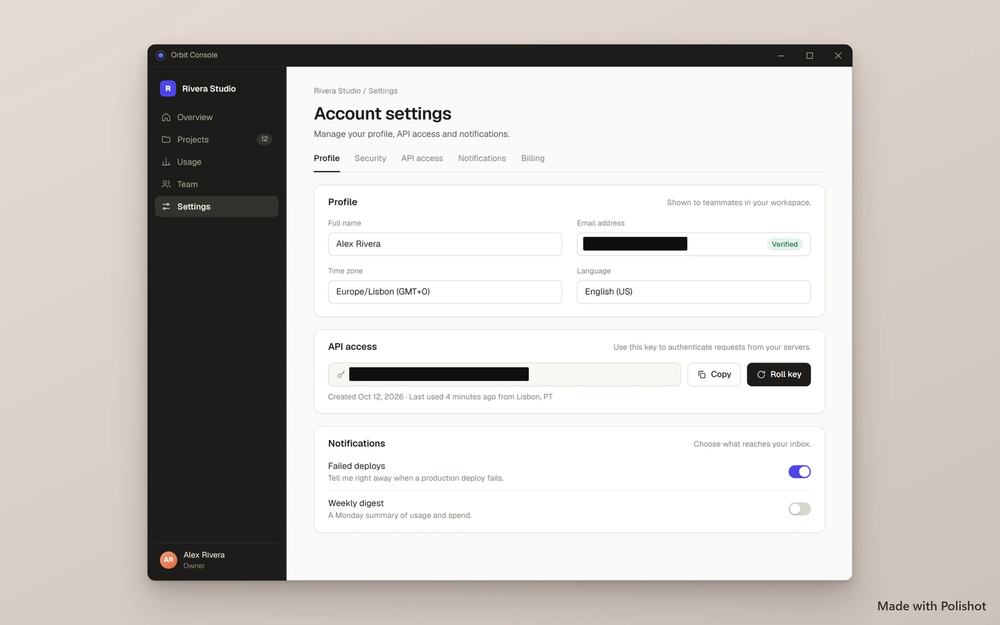

# Polishot

**Polished screenshots, private by default.** Take a screenshot, and Polishot frames it, hides anything sensitive, and gets it ready to share in about two seconds. It all happens on your own device.

Windows and Android. Try it at **[polishot.cam](https://polishot.cam)**.



## Why I made it

Every time I shared a screenshot, I did the same things by hand: crop it, add some padding so it doesn't look cramped, and blur my email or an API key before posting. The tools that do this well are Mac-only, or upload your screenshots to a server. I wanted one that's fast, works on Windows and Android, and never sends my screenshots anywhere.

## What it does

- **Capture** a region or a window with one shortcut on Windows, or from the notification on Android.
- **Auto-balance** trims the borders and adds even padding, with a background picked from the screenshot's own colors.
- **Auto-redact** finds emails, card numbers, IP addresses and API keys, and covers them before you share.
- **Copy the text** out of any screenshot (OCR runs on your device).
- **Quick send** images between your phone and PC over your own Wi-Fi, encrypted, with no account.
- **Export** as PNG, JPEG or WebP at 1x to 3x, or with presets for X, LinkedIn, Instagram and YouTube.

## Get it

Download for Windows or Android from **[polishot.cam/download](https://polishot.cam/download)**. It's free with every feature.

The Windows installer isn't code-signed yet, so SmartScreen will warn you. Click **More info**, then **Run anyway**.

## Run it yourself

You need Node 24, pnpm 12 and Rust (stable).

```bash
pnpm install
pnpm dev:web        # the website, on http://localhost:3000
pnpm dev:desktop    # the Windows app (needs the MSVC build tools)
pnpm test           # unit tests
```

For Android, open `apps/android` in Android Studio. More detail on the layout, the tests and how releases work is in [docs/DEVELOPING.md](docs/DEVELOPING.md).

## How it's built

- **Windows app:** Tauri 2 (Rust) with a React UI
- **Android app:** Kotlin and Jetpack Compose
- **Editor:** one Konva + React editor, shared by both apps and the website
- **Website:** Next.js on Vercel

## Status

Polishot is a work in progress. Version 0.1.0 is out. Next up:

- crop, rotate and more editing tools
- quick send that just works
- automatic updates

[docs/UNVERIFIED.md](docs/UNVERIFIED.md) lists what hasn't been tested on real hardware yet.

A paid Pro version is planned but on hold for now, so everything is free.

## License

The source is open to read, build and report issues against. A license hasn't been chosen yet. Until one is added, all rights are reserved, so please ask before reusing the code.
